<div align="center">

<a href="https://annoris.github.io/kineta">
  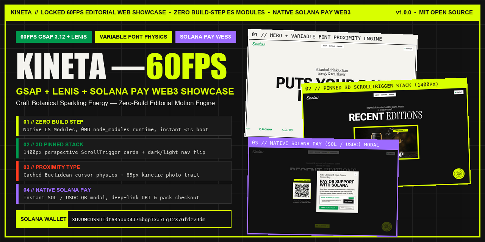
</a>

<br />
<br />


# KINETA — Craft Botanical Sparkling Energy

### **A Locked-60fps Editorial Web Showcase, Kinetic Typography Engine & Web3 Solana Pay Experience Built with Zero Build-Step Overhead**

[](https://annoris.github.io/kineta)
[](https://github.com/annoris/kineta/stargazers)
[](https://github.com/annoris/kineta/fork)
[](./FUNDING.md)
[](./LICENSE)
[](./docs/ARCHITECTURE.md)
[](#4-pinned-3d-perspective-editions-stack-ediciones--dark-theme)

<br />

[](https://twitter.com/intent/tweet?text=Just%20discovered%20KINETA%20%E2%80%94%20an%20insane%20locked-60fps%20editorial%20web%20showcase%20built%20with%20zero%20build-step%20overhead%2C%20variable%20font%20proximity%20physics%2C%20GSAP%20ScrollTrigger%203D%20stacks%20%26%20native%20Solana%20Pay!%20%E2%9A%A1%F0%9F%8D%8B%20https%3A%2F%2Fgithub.com%2Fannoris%2Fkineta)
[](https://news.ycombinator.com/submitlink?u=https%3A%2F%2Fgithub.com%2Fannoris%2Fkineta&t=Show%20HN%3A%20Kineta%20%E2%80%93%20Locked-60fps%20GSAP%20%2B%20Lenis%20editorial%20web%20showcase%20with%20zero%20build%20step%20%26%20Solana%20Pay)
[](https://www.reddit.com/submit?url=https%3A%2F%2Fgithub.com%2Fannoris%2Fkineta&title=KINETA%20%E2%80%94%20Locked-60fps%20GSAP%20%2B%20Lenis%20editorial%20web%20showcase%20built%20with%20zero%20build-step%20overhead%20%26%20Solana%20Pay)
[](https://solscan.io/account/3HvUMCUSSHEdtA35UuD4J7mbgpTxJ7LgT2X7GfdzvBdm)
[](https://github.com/annoris/kineta/releases/tag/v1.0.0)

<br />

[**🚀 Launch Live Demo**](https://annoris.github.io/kineta) · [**📸 Visual Walkthrough**](#-complete-visual-walkthrough--live-section-gallery) · [**🏛️ 60fps Architecture**](#️-system-architecture--mermaid-diagrams) · [**🎨 Studio Asset Gallery**](#-complete-studio-photography--svg-sticker-library) · [**⚡ Quick Start**](#-quick-start--zero-build-deployment) · [**💎 Solana Pay & Sponsorship**](#-support--web3-sponsorship-solana--sol--usdc) · [**📈 Star History**](#-star-history--community-showcase)

</div>

---

> [!IMPORTANT]
> ### ⭐ Why Star KINETA Right Now?
> **KINETA** is a production-ready **Awwwards-grade creative engineering showcase** — zero Webpack/Vite bloat, zero `node_modules` lock-in, locked **60fps** GSAP + Lenis choreography, and native **Solana Pay (`SOL` / `USDC`)** checkout out of the box.
>
> - ⭐ **[Star this repository](https://github.com/annoris/kineta/stargazers)** to bookmark the 13-stage GSAP + Lenis + Variable Font Proximity showcase and architectural documentation.
> - 🚀 **[Explore the Live 60fps Showcase](https://annoris.github.io/kineta)** directly in your browser to experience every motion system, 3D stack, and overlay.
> - 👀 **[Watch Releases & Join the Roadmap Thread](https://github.com/annoris/kineta/issues/1)** to follow upcoming WebGL shaders, custom audio-reactive motion hooks, and Solana Pay receipt features.
> - 💎 **[Sponsor via Solana (`3HvUMCUSSHEdtA35UuD4J7mbgpTxJ7LgT2X7GfdzvBdm`)](./FUNDING.md)** to support ongoing 60fps creative engineering R&D!

---

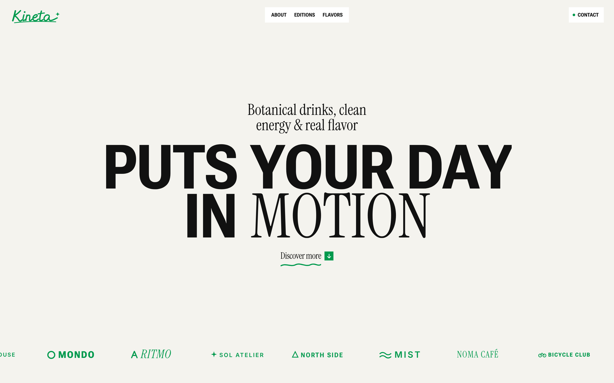

> **"What happens when you strip away 400MB of `node_modules`, Webpack/Vite bundlers, and sluggish CSS blurs — and engineer an Awwwards-grade editorial experience directly on native ES Modules, GPU-composited transforms, variable font proximity math, and instant Solana Pay?"**
>
> **Answer: KINETA.** Locked **60fps** from the very first frame, **0ms preloader block**, crisp **`0px` brutalist geometry**, and **Proprietary / All Rights Reserved** architecture.

---

## ⚡ Why KINETA Exists (The Viral Hook)

Modern creative agency and DTC beverage websites often suffer from two extremes: either they are sterile corporate templates, or they are bloated WebGL/bundler monoliths that choke mobile GPUs, drop frames on scroll, and require gigabytes of build tooling just to render a landing page.

**KINETA** was engineered as the ultimate reference implementation for **high-craft, zero-build creative engineering**:

1. **Zero Build Step, Instant Native ES Modules (`type="module"`)**: No Webpack, no Vite, no Babel, no TypeScript compilation step. Clone the repo and serve it with any static HTTP server in **< 1 second**.
2. **Locked 60fps Frame Budget (`Zero Blur, Zero Layout Thrash`)**:
   - **No `backdrop-filter: blur()`** anywhere in the stylesheet (the #1 silent killer of 60fps scrolling on Retina displays).
   - **No `getBoundingClientRect()` inside `pointermove` or `requestAnimationFrame` loops** — bounding boxes are cached once on `pointerenter`.
   - **Quantized Variable Font Proximity Hover** (`--wght` steps of `30` scoped exclusively to the hovered heading) with zero `will-change` layer explosion.
3. **Single-Ticker Lenis + GSAP ScrollTrigger Synchronization**: Virtual scroll delta clamping (`[-100, 100]`) driven by a single `gsap.ticker` loop with `lagSmoothing(0)`.
4. **Native Web3 Commerce & Open-Source Sponsorship via Solana Pay**: Built-in interactive **Solana Pay (`SOL` / `USDC`)** checkout modal with an instant SVG QR code, `solana:` URI deep-linking for Phantom/Solflare/Backpack, and one-click clipboard copy for wallet **`3HvUMCUSSHEdtA35UuD4J7mbgpTxJ7LgT2X7GfdzvBdm`**.

---

## 📑 Table of Contents

- [⚡ Why KINETA Exists (The Viral Hook)](#-why-kineta-exists-the-viral-hook)
- [📸 Complete Visual Walkthrough & Live Section Gallery](#-complete-visual-walkthrough--live-section-gallery)
  - [1. Editorial Hero & Variable Font Proximity Engine (`#hero`)](#1-editorial-hero--variable-font-proximity-engine-hero)
  - [2. Desktop Hero Cursor-Following Photo Stack (`.cursor-card.is-home`)](#2-desktop-hero-cursor-following-photo-stack-cursor-cardis-home)
  - [3. The Makers Behind Kineta — Interactive Polaroid Collage (`#intro`)](#3-the-makers-behind-kineta--interactive-polaroid-collage-intro)
  - [4. Pinned 3D Perspective Editions Stack (`#ediciones` — Dark Theme)](#4-pinned-3d-perspective-editions-stack-ediciones--dark-theme)
  - [5. Permanent Lineup — "What We Craft" Tilted Trio (`#sabores`)](#5-permanent-lineup--what-we-craft-tilted-trio-sabores)
  - [6. Asymmetric 4-Column Team Parallax & Momentum Stickers (`#equipo`)](#6-asymmetric-4-column-team-parallax--momentum-stickers-equipo)
  - [7. Kinetic Footer & 85px Pointer Image Trail (`#contacto`)](#7-kinetic-footer--85px-pointer-image-trail-contacto)
  - [8. Interactive Overlays: Edition Modal, Pack Builder Drawer, Solana Pay & Cookie Card](#8-interactive-overlays-edition-modal-pack-builder-drawer-solana-pay--cookie-card)
  - [9. Responsive Mobile Architecture & Full-Screen Drawer (`< 992px`)](#9-responsive-mobile-architecture--full-screen-drawer--992px)
- [🎨 Complete Studio Photography & SVG Sticker Library](#-complete-studio-photography--svg-sticker-library)
- [🏛️ System Architecture & Mermaid Diagrams](#️-system-architecture--mermaid-diagrams)
- [🎨 Signature Editorial Palette & Fluid Typography System](#-signature-editorial-palette--fluid-typography-system)
- [🚀 Quick Start & Zero-Build Deployment](#-quick-start--zero-build-deployment)
- [💎 Support & Web3 Sponsorship (Solana — SOL / USDC)](#-support--web3-sponsorship-solana--sol--usdc)
- [📣 Viral Launch Kit (X, Hacker News, Reddit, Product Hunt)](#-viral-launch-kit-x-hacker-news-reddit-product-hunt)
- [📈 Star History & Community Showcase](#-star-history--community-showcase)
- [📜 Governance & Proprietary License](#-governance--proprietary-license)

---

## 📸 Complete Visual Walkthrough & Live Section Gallery

Every view, scroll state, interactive physics layer, and overlay of the **KINETA** website is documented below with high-resolution Retina (`2880×1800`) captures stored directly in [`docs/images/`](./docs/images/).

---

### 1. Editorial Hero & Variable Font Proximity Engine (`#hero`)


#### Technical & Functional Breakdown
- **Instant Page-Ready Paint (`document.documentElement.dataset.pageReady = 'true'`)**: Zero artificial loading screens or blocking preloaders. The hero SplitText lines (`PUTS YOUR DAY / IN MOTION`) immediately execute an upward masked reveal (`yPercent: 110 → 0`, `power4.out`, `stagger: 0.09s`).
- **Dual-Font Variable Typography Pairing**:
  - Primary display characters render in condensed **`Roboto Flex`** (`font-variation-settings: 'wght' 700, 'wdth' 75, 'opsz' 30`).
  - The accent word **`MOTION`** renders in upright editorial serif **`Instrument Serif`** (`.heading-alt`).
- **Proximity Font-Weight Physics (`[data-font-weight-hover]`)**: Moving the pointer across the giant `12em` headline computes the Euclidean distance (`Math.hypot(dx, dy)`) from the cursor to each character's cached center point within a dynamic radius (`180px–340px`), smoothly modulating `--wght` between `700` and `210` in quantized steps of `30`.
- **0% JS CPU Stockists Marquee (`.hero_clients`)**: The bottom partner strip (*GREENHOUSE, MONDO, RITMO, SOL ATELIER, NORTH SIDE, MIST, NOMA CAFÉ, BICYCLE CLUB*) clones its collection once at startup (`[data-marquee-duplicate="2"]`) and runs entirely on a GPU-composited CSS `@keyframes marqueeScroll` loop (`translate3d(-50%, 0, 0)`), pausing cleanly on hover.
- **Fixed Adaptive Header (`.nav`)**: Features the inline `currentColor` script wordmark (`logo-kineta.svg`), centered crisp white navigation bar (`ABOUT`, `EDITIONS`, `FLAVORS`, `SOLANA PAY`) with hand-drawn persistent SVG underlines (`[data-draw-line-persist]`), and the `.button-093` contact CTA with 4 orbital spring dots and a `75deg` rotational text swap.

---

### 2. Desktop Hero Cursor-Following Photo Stack (`.cursor-card.is-home`)

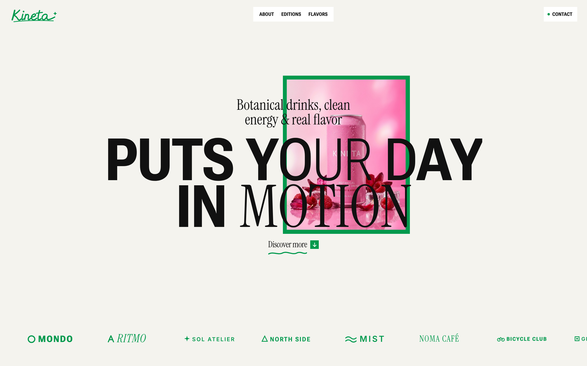

#### Technical & Functional Breakdown
- **On-Demand `requestAnimationFrame` Lerp Follower**: On desktop viewports (`min-width: 992px`), the `.cursor-card.is-home` media stack remains hidden until the user moves their pointer inside `.section_hero`.
- **130px Euclidean Travel Cycling**: As the cursor moves across the hero canvas, `initHeroCursorCard()` accumulates travel distance (`Math.hypot(e.clientX - lastCycleX, e.clientY - lastCycleY)`). Every **`130px`** of pointer travel, the card cycles smoothly through 4 framed studio photographs (*Volt Yuzu*, *Berry Pulse*, *Solar Mango*, and *Night Drop*).
- **Zero Idle CPU**: The interpolation loop (`lerp(cur, target, 0.14)`) automatically terminates its `requestAnimationFrame` handle as soon as `|target - cur| <= 0.25px` or when the pointer leaves the hero section.

---

### 3. The Makers Behind Kineta — Interactive Polaroid Collage (`#intro`)

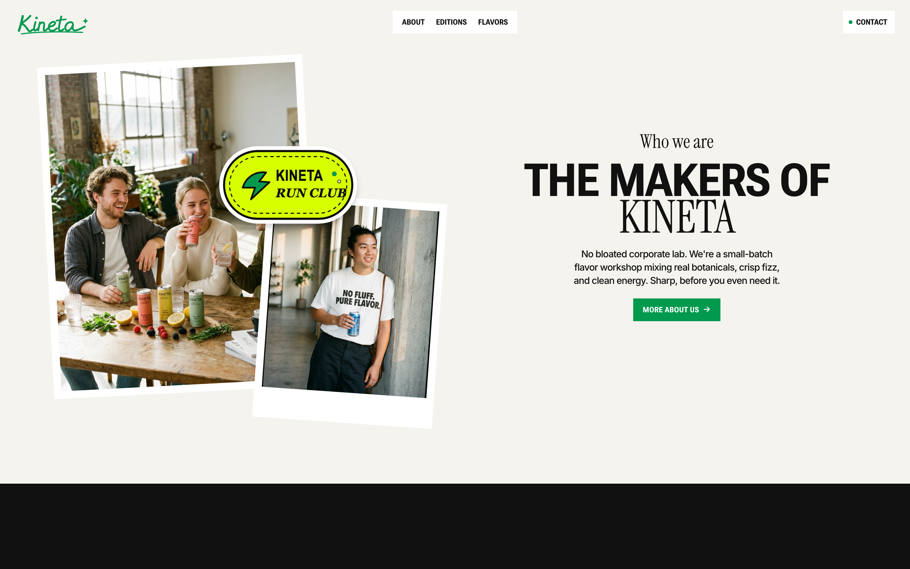

#### Technical & Functional Breakdown
- **2-Column Editorial Story Architecture (`.intro_wrapper`)**: Pairs punchy anti-corporate studio copy (*"No bloated corporate lab. We're a small-batch flavor workshop mixing real botanicals, crisp fizz, and clean energy."*) with a multi-layered physical Polaroid collage.
- **Cached-Rect Multi-Depth Parallax (`[data-interactive-collage-init]`)**:
  - **Large Polaroid (`.intro-media-l`)**: Rotated `-3deg` at depth factor `14px`, showcasing small-batch botanical tasting in the studio workshop.
  - **Medium Polaroid (`.intro-media-m`)**: Rotated `+4deg` at depth factor `20px`, featuring the `"NO FLUFF. PURE FLAVOR."` editorial portrait.
  - **Die-Cut Sticker Badge (`.intro-media-s`)**: Overlapping Acid Chartreuse **`KINETA RUN CLUB`** badge (`sticker-run-club.svg`) shifting at depth factor `24px`.
  - Inner cards are animated separately from outer wrappers so base CSS rotations (`-3deg`, `+4deg`) never collide with GSAP `x`/`y` parallax transforms.
- **Spring Editorial Button (`.button-052`)**: Clicking **`MORE ABOUT US`** triggers a `-3deg` spring lift with dual sliding SVG arrows.

---

### 4. Pinned 3D Perspective Editions Stack (`#ediciones` — Dark Theme)

````carousel
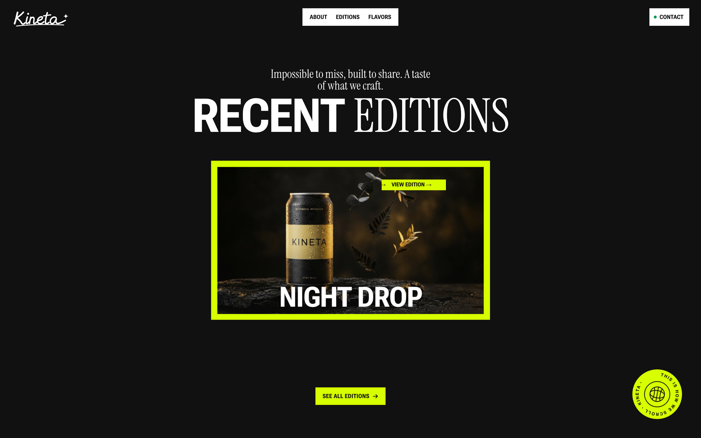
<!-- slide -->
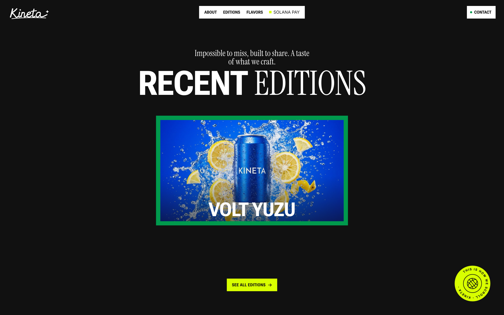
<!-- slide -->
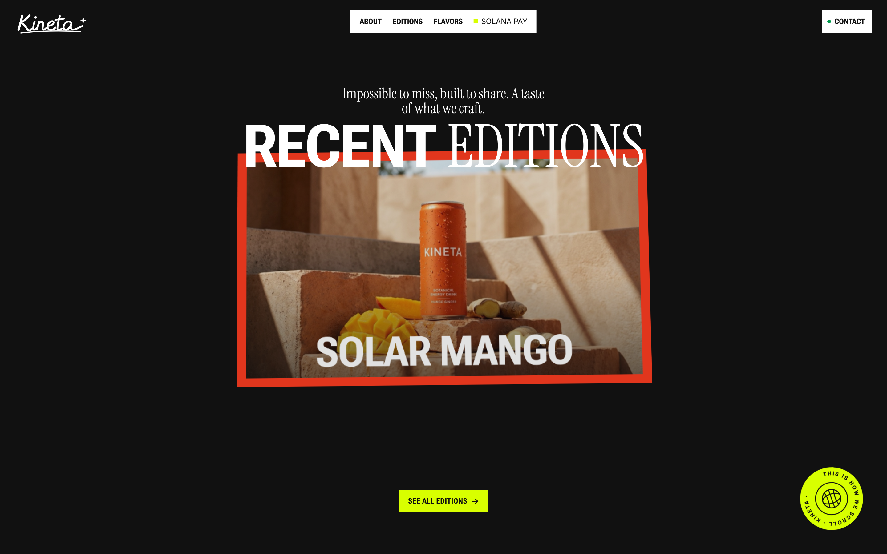
````

| Slide 01: Night Drop (`#D8FF00`) | Slide 02: Volt Yuzu (`#00994D`) | Slide 03: Solar Mango (`#FF3B1F`) |
| :---: | :---: | :---: |
|  |  |  |

#### Technical & Functional Breakdown
- **Instant Dark/Light Navbar Inversion (`[data-nav-theme="dark"]`)**: When `#ediciones` crosses the top `48px` viewport threshold, `ScrollTrigger` toggles `data-nav-theme-active="dark"` on `<header class="nav">`, instantly inverting the `currentColor` Kineta script wordmark from Electric Emerald (`#00994D`) to crisp White (`#FFFFFF`) against the Matte Obsidian (`#111111`) canvas.
- **True 3D Perspective Depth Stack (`perspective: 1400px`, `transform-style: preserve-3d`)**:
  - Engineered inside `initFeaturedStack()` using `gsap.matchMedia('(min-width: 992px)')` with `pin: true`, `scrub: 0.35`, `end: '+=220%'`, and `anticipatePin: 1`.
  - **Initial Z-Space Slots**:
    - **Card 01 (`NIGHT DROP`)**: `(x: 0, y: 0px, z: 0px, zIndex: 3)` — framed in **Acid Chartreuse (`#D8FF00`)**.
    - **Card 02 (`VOLT YUZU`)**: `(x: 0, y: -40px, z: -120px, zIndex: 2)` — framed in **Electric Emerald (`#00994D`)**.
    - **Card 03 (`SOLAR MANGO`)**: `(x: 0, y: -80px, z: -240px, zIndex: 1)` — framed in **Coral Vermilion (`#FF3B1F`)**.
  - As the user scrolls, the active front card lifts upward (`yPercent: -115`), pitches in 3D space (`rotationX: 14deg`, alternating `rotationZ: ±5deg`), and fades out while the remaining cards advance one full 3D depth slot toward `(0, 0, 0)`.
- **Floating Pointer-Follower Marquee Pill (`.cursor-marquee`)**: Hovering any edition card spawns a high-contrast Acid Chartreuse cursor follower displaying a continuous **`VIEW EDITION →`** marquee ticker. Clicking any card opens the **Edition Detail Modal**.
- **Continuous Scroll Badge (`.featured_scroll-svg`)**: Bottom-right rotating badge (`scroll-badge.svg` — *"THIS IS HOW WE SCROLL • KINETA •"*) running on an `18s` linear CSS rotation loop.

---

### 5. Permanent Lineup — "What We Craft" Tilted Trio (`#sabores`)

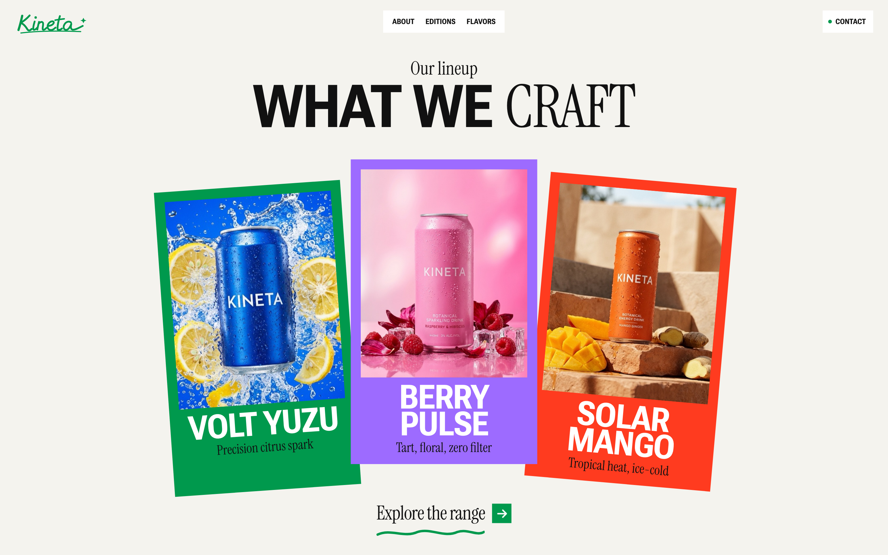

#### Technical & Functional Breakdown
- **Editorial Fan Geometry (`.services-cards_list`)**: On desktop viewports, the three core product cards fan out across the Warm Paper (`#F4F3EE`) canvas:
  1. **VOLT YUZU (`#00994D` Electric Emerald)** — *"Precision citrus spark"* (`translateY(4em) rotate(-4deg)`).
  2. **BERRY PULSE (`#9D6BFF` Electric Lavender)** — *"Tart, floral, zero filter"* (`rotate(0deg)`, elevated `z-index: 2`).
  3. **SOLAR MANGO (`#FF3B1F` Coral Vermilion)** — *"Tropical heat, ice-cold"* (`translateY(3em) rotate(5deg)`).
- **Interactive Collage & Hover Zoom (`[data-video-on-hover]`)**: Hovering a flavor card activates `data-video-on-hover="active"`, scaling the high-resolution studio can photography (`scale(1.07)`) with an `--ease-out-expo` curve while shifting adjacent cards in counter-parallax.
- **Direct Pack Preset Wiring (`[data-preset-flavor]`)**: Clicking any of the three flavor cards opens the **Build Your Pack Drawer** pre-loaded with 4 cans of that selected flavor + 1 of each companion flavor.

---

### 6. Asymmetric 4-Column Team Parallax & Momentum Stickers (`#equipo`)

| Upper Editorial Grid & `KN` Badge | Lower Editorial Grid & `KINETA` Sticker |
| :---: | :---: |
| 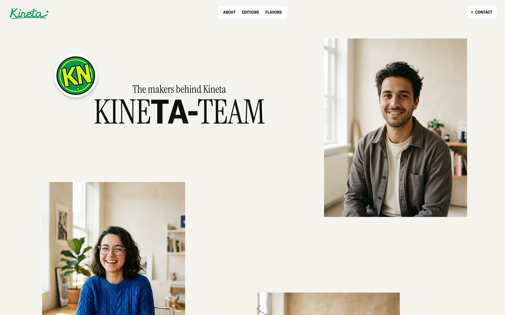 | 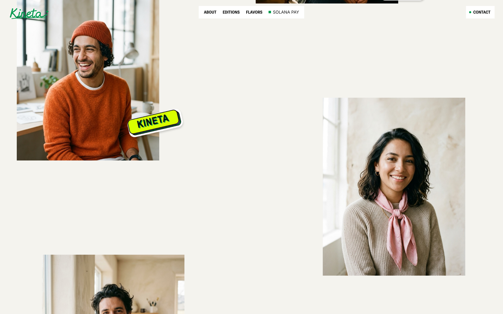 |

#### Technical & Functional Breakdown
- **Asymmetric 4-Column Desktop Architecture (`.team_list`)**: Six borderless, full-bleed `4:5` studio portraits are positioned across a 4-column grid (`grid-template-columns: repeat(4, 1fr)`) with intentional negative-space offsets (`translateX`, `translateY`) and an overlapping giant `KINETA-Team` display header.
- **Scrubbed Multi-Velocity Vertical Parallax (`[data-team-parallax-distance="200"]`)**: `initTeamParallax()` drives each portrait's inner `.team_card` along opposite vertical scroll vectors (`scrub: 0.35`) so the grid breathes organically as the user scrolls.
- **Pointer-Velocity Inertia & Elastic Spring Physics (`[data-momentum-hover-init]`)**:
  - Sweeping the cursor across any team portrait or die-cut studio sticker (`sticker-kn.svg`, `sticker-kineta.svg`, `sticker-puro-sabor.svg`) measures instantaneous pointer velocity (`vx = dx / dt`, `vy = dy / dt` in pixels/ms).
  - When velocity exceeds `0.35 px/ms`, `initMomentumHover()` flings the target along the cursor's trajectory (`x: clamp(vx * 18, -32, 32)`, `y: clamp(vy * 18, -28, 28)`, `rotation: clamp(vx * 5.5, -9, 9)`) over `0.22s`, then rebounds back to rest over `1.15s` using a physical **`elastic.out(1, 0.45)`** spring curve.

---

### 7. Kinetic Footer & 85px Pointer Image Trail (`#contacto`)

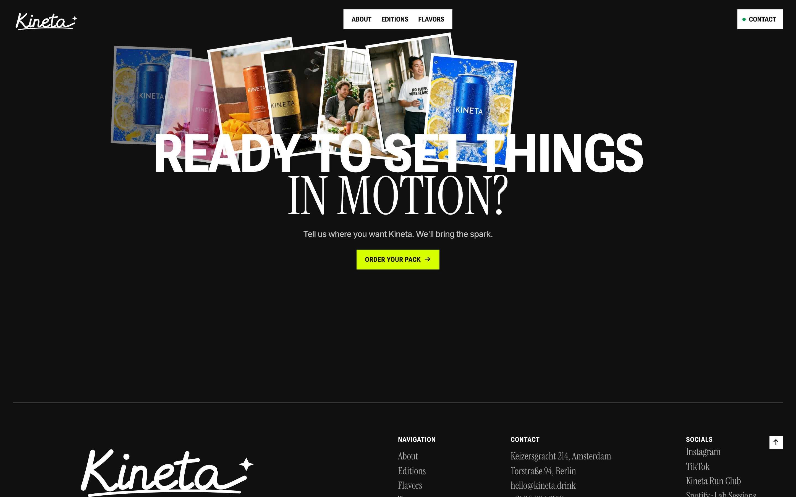

#### Technical & Functional Breakdown
- **Interactive Photographic Trail Zone (`.footer-cta[data-image-trail]`)**:
  - Moving the cursor across the `"READY TO SET THINGS IN MOTION?"` call-to-action zone tracks cumulative pointer distance relative to the cached container bounding box.
  - Every **`85px`** of pointer movement (capped at `MAX_ACTIVE_NODES = 14` concurrent DOM elements), `initFooterImageTrail()` spawns a framed studio photograph (`.created-img`) with a random editorial tilt (`-10deg` to `+10deg`).
  - Each spawned photo pops into view (`scale: 0.65 → 1`, `back.out(1.7)`, `0.34s`), lingers for `0.45s`, and cascades downward while fading out (`y: 26`, `scale: 0.82`, `opacity: 0`, `0.55s`) before removing itself from the DOM.
- **Lazy Cache Warming (`initCanvasArt()`)**: The 6 trail photographs are lazily pre-warmed into the browser's decoded image cache on the first `pointerenter` event over `[data-image-trail]`, ensuring zero network lag during rapid mouse sweeps.
- **3-Column Studio Directory & Smooth Scroll-to-Top**: Features navigation anchors, Amsterdam & Berlin lab coordinates (*Keizersgracht 214, Amsterdam* & *Torstraße 94, Berlin*), social links, direct **Solana Pay** trigger, and a spring-animated `.scroll-top-btn`.

---

### 8. Interactive Overlays: Edition Modal, Pack Builder Drawer, Solana Pay & Cookie Card

| Edition Detail Modal (`#edition-modal`) | Order Pack Builder Drawer (`#order-drawer`) |
| :---: | :---: |
| 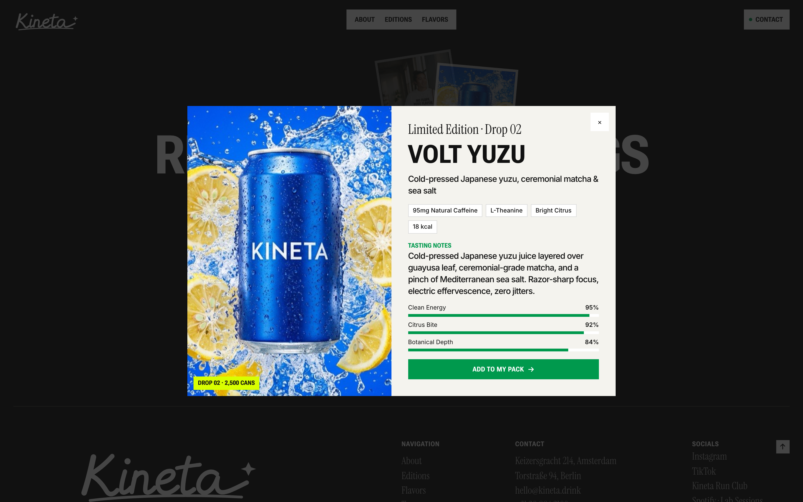 | 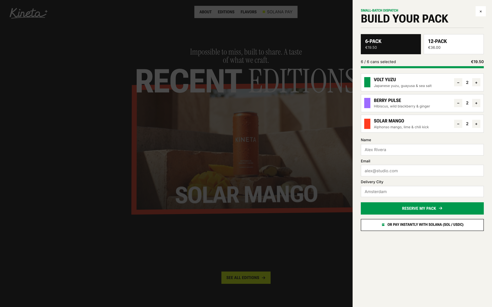 |
| **Solana Pay Web3 Modal (`#solana-modal`)** | **Crisp Brutalist Cookie Card (`#cookie-consent`)** |
| 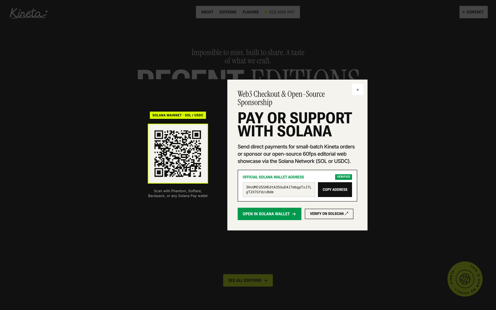 | 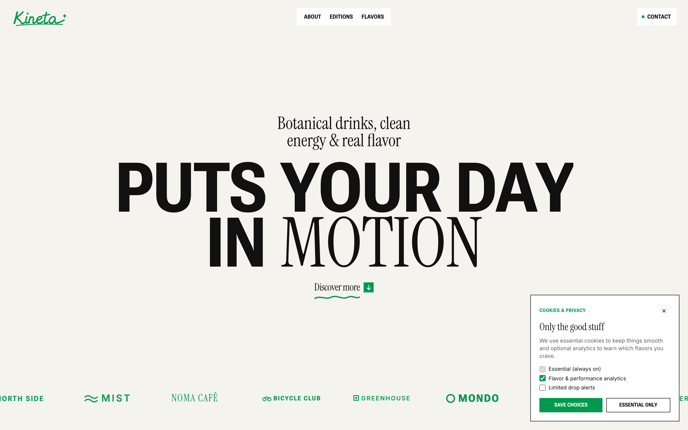 |

#### Technical & Functional Breakdown
1. **Edition Detail Modal (`#edition-modal`)**:
   - Dynamically populates studio photography, batch metadata (`DROP 01 · 1,200 CANS`, `DROP 02 · 2,500 CANS`, `DROP 03 · 1,800 CANS`), spec pills (`95mg Natural Caffeine`, `L-Theanine`, `Bright Citrus`, `18 kcal`), tasting notes, and animated percentage meters (*Clean Energy 95%*, *Citrus Bite 92%*, *Botanical Depth 84%*).
   - Clicking **`ADD TO MY PACK →`** seamlessly closes the modal and opens the **Order Pack Builder Drawer** pre-configured with that edition's flavor profile.
2. **Order Pack Builder Drawer (`#order-drawer`)**:
   - Real-time state machine supporting **6-PACK (`€19.50`)** and **12-PACK (`€36.00`)** configurations.
   - Interactive `+` / `−` flavor steppers for *Volt Yuzu*, *Berry Pulse*, and *Solar Mango* with live progress bar (`6 / 6 cans selected`), form validation, generated reservation receipt (`#KN-XXXXX`), and an integrated **Instant Solana Pay (`SOL` / `USDC`)** checkout trigger.
3. **Solana Pay & Open-Source Sponsorship Modal (`#solana-modal`)**:
   - Accessible from the top navigation bar (`SOLANA PAY`), the Pack Builder checkout drawer, and the footer.
   - Displays a crisp high-contrast **SVG QR Code** encoded with `3HvUMCUSSHEdtA35UuD4J7mbgpTxJ7LgT2X7GfdzvBdm`, one-click clipboard copy with visual `COPIED ✓` confirmation, direct `solana:` wallet deep-link button (`OPEN IN SOLANA WALLET`), and a live verification link to **Solscan**.
4. **Crisp Brutalist Cookie Consent Card (`#cookie-consent`)**:
   - Zero-blur, `1px solid #111111` card persisted in `localStorage` (`kineta_cookie_consent_v1`) with granular toggles for *Essential*, *Flavor & performance analytics*, and *Limited drop alerts*. Can be re-opened anytime via footer legal links (`[data-open-cookie-settings]`).

---

### 9. Responsive Mobile Architecture & Full-Screen Drawer (`< 992px`)

| Mobile Hero Viewport (`390×844` iPhone 14 Pro) | Mobile Full-Screen Navigation Drawer (`#mobile-nav-drawer`) |
| :---: | :---: |
| 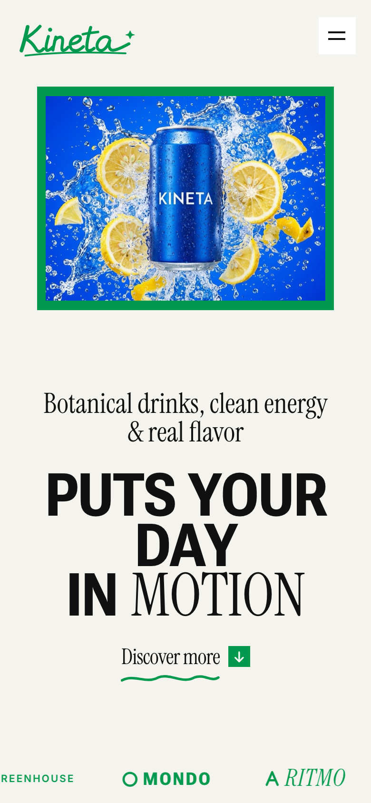 | 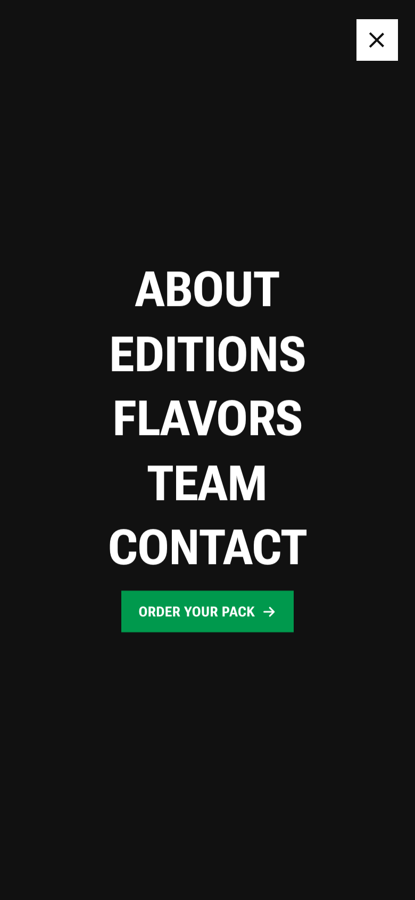 |

#### Technical & Functional Breakdown
- **Fluid Root Viewport Scaling (`base.css`)**: Scales `body` font-size proportionally across 4 responsive breakpoints (`1920px`, `991px`, `767px`, `479px`) using `clamp()` and `100dvw` so every `em`-based heading, card, and gutter maintains exact editorial proportions on phones, tablets, laptops, and 4K monitors.
- **Touch-First Ergonomics**: Automatically disables desktop-only floating cursor followers on coarse pointers (`@media (hover: none), (pointer: coarse)`), converts the hero cursor stack into a tactile inline hero card, and provides a full-screen Matte Obsidian mobile navigation drawer (`data-nav-status="open"`).

---

## 🎨 Complete Studio Photography & SVG Sticker Library

In addition to the 16 live UI captures in [`docs/images/`](./docs/images/), all **12 high-resolution editorial studio photographs** ([`src/assets/images/`](./src/assets/images/)) and **8 custom vector assets & die-cut stickers** ([`src/assets/svg/`](./src/assets/svg/)) are included directly in the repository and rendered below:

### Product Editions & Story Polaroids (`src/assets/images/`)

| `featured-night-drop.jpg` | `featured-volt-yuzu.jpg` | `featured-solar-mango.jpg` |
| :---: | :---: | :---: |
| 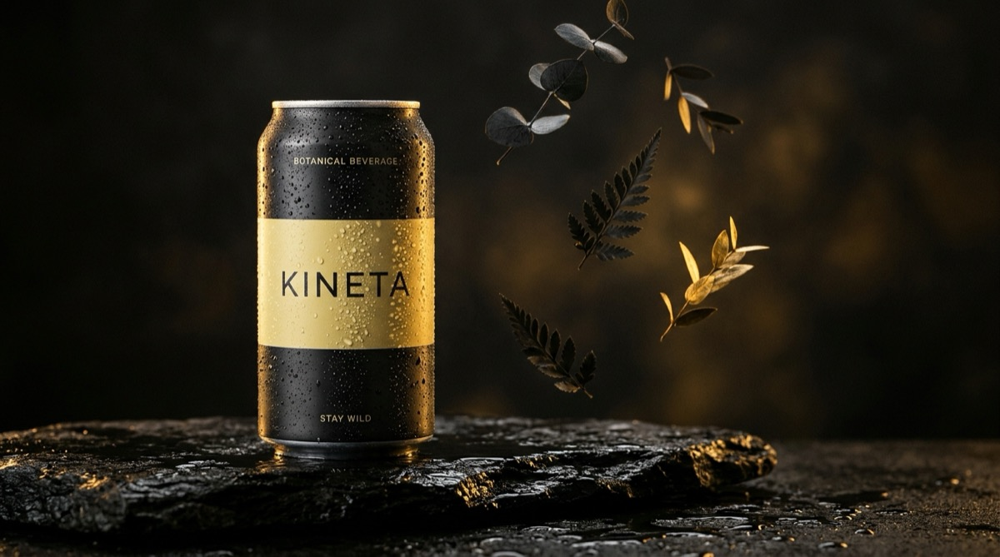 | 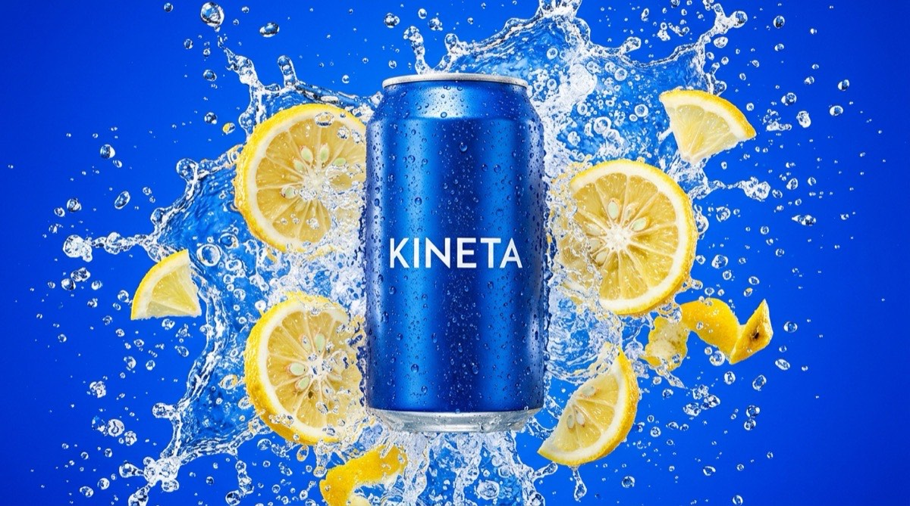 | 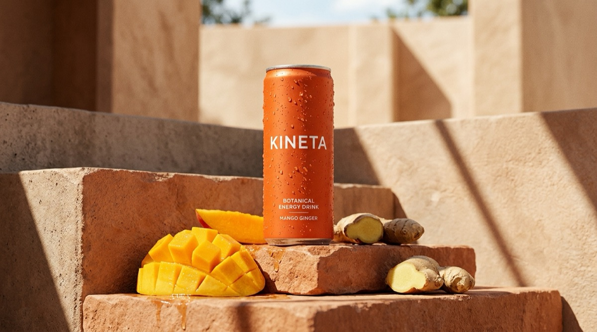 |
| **Night Drop (Drop 01)** — Smoked yerba mate, raw cacao & bitter orange | **Volt Yuzu (Drop 02)** — Cold-pressed Japanese yuzu, ceremonial matcha & sea salt | **Solar Mango (Drop 03)** — Ripe Alphonso mango, Amazonian guayusa & ginger fire |

| `flavor-berry-pulse.jpg` | `intro-polaroid-1.jpg` | `intro-polaroid-2.jpg` |
| :---: | :---: | :---: |
| 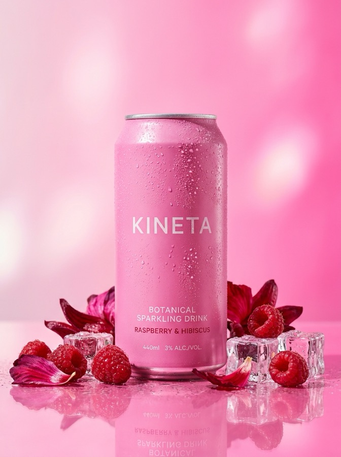 | 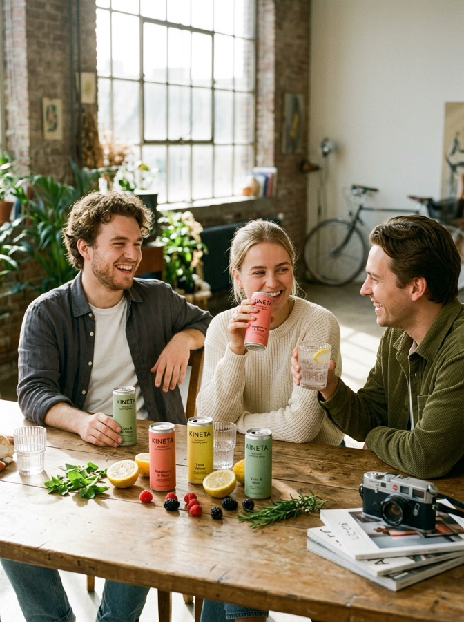 | 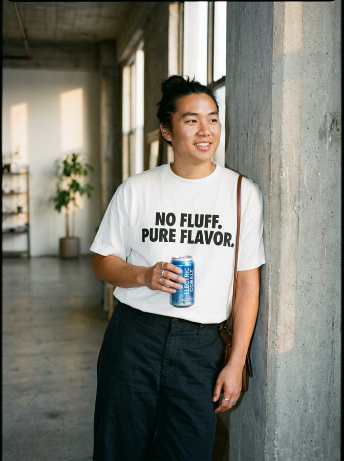 |
| **Berry Pulse** — Real hibiscus petals, wild blackberry & fresh ginger root | **Workshop Polaroid 01** — Small-batch botanical tasting table | **Workshop Polaroid 02** — *"No Fluff. Pure Flavor."* portrait |

### Editorial Team Portraits (`src/assets/images/team-1.jpg` … `team-6.jpg`)

| Mateo Serrano (`team-1.jpg`) | Lucia Navarro (`team-2.jpg`) | Sofia Mendoza (`team-3.jpg`) |
| :---: | :---: | :---: |
|  |  |  |
| *Head Botanist & Co-Founder* | *Creative Director & Co-Founder* | *Flavor Chemist & R&D Lead* |

| Diego Morales (`team-4.jpg`) | Valeria Rios (`team-5.jpg`) | Bruno Castillo (`team-6.jpg`) |
| :---: | :---: | :---: |
|  |  |  |
| *Production & Limited Drops* | *Community & Kineta Run Club* | *Brand Designer & Visual Culture* |

### Die-Cut SVG Stickers, Wordmark & Custom Cursors (`src/assets/svg/`)

| `logo-kineta.svg` | `sticker-run-club.svg` | `sticker-kineta.svg` | `sticker-kn.svg` |
| :---: | :---: | :---: | :---: |
|  | 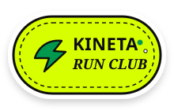 | 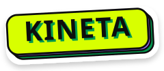 |  |
| Expressive Script Wordmark | `KINETA RUN CLUB` Die-Cut Badge | Layered 3D `KINETA` Studio Sticker | `KN` Monogram Studio Badge |

| `sticker-puro-sabor.svg` | `scroll-badge.svg` | `cursor-default.svg` | `cursor-pointer.svg` |
| :---: | :---: | :---: | :---: |
| 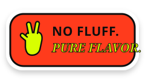 |  |  |  |
| `NO FLUFF. PURE FLAVOR.` Badge | Rotating `THIS IS HOW WE SCROLL` Seal | Custom Matte Obsidian Cursor | Custom Electric Emerald Pointer |

---

## 🏛️ System Architecture & Mermaid Diagrams

### 1. Zero-Build Module & Motion Pipeline

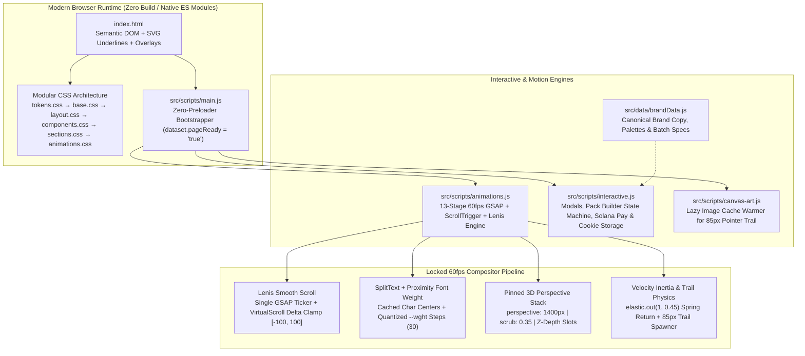

### 2. User Interaction & Web3 Solana Checkout Sequence

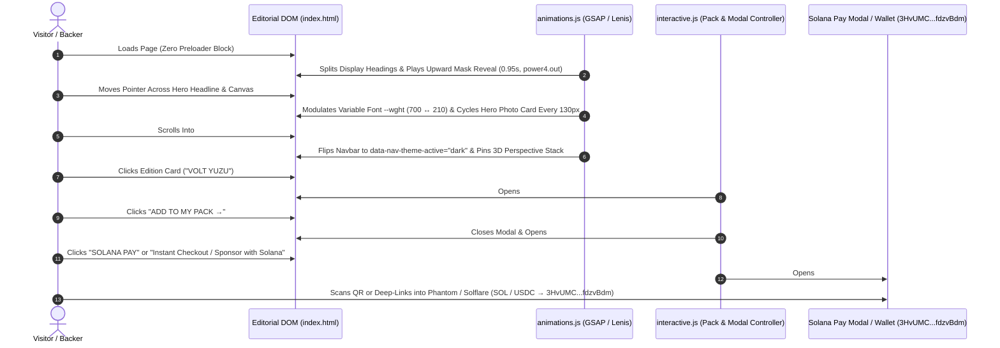

---

## 🎨 Signature Editorial Palette & Fluid Typography System

**KINETA** alternates between warm tactile paper and deep matte obsidian surfaces, punctuated by four high-voltage botanical accent tokens defined in `src/styles/tokens.css`:

| CSS Custom Property | Token Role | Color Name | Hex | Preview Swatch |
| :--- | :--- | :--- | :--- | :---: |
| `--color-bg-light` | Primary Light Canvas | **Warm Paper** | `#F4F3EE` |  |
| `--color-bg-dark` | Primary Dark Canvas (`.theme-dark`) | **Matte Obsidian** | `#111111` |  |
| `--color-accent` | Primary Botanical Accent (*Volt Yuzu*) | **Electric Emerald** | `#00994D` |  |
| `--color-lime` | Kinetic Highlight (*Night Drop* / Dark CTAs) | **Acid Chartreuse** | `#D8FF00` |  |
| `--color-lavender` | Secondary Pop Accent (*Berry Pulse*) | **Electric Lavender** | `#9D6BFF` |  |
| `--color-coral` | High-Energy Signal (*Solar Mango*) | **Coral Vermilion** | `#FF3B1F` |  |

### Typography & DOM Hook Contract

| Hook Attribute / Class | Target Elements | Engine Module | Runtime Behavior |
| :--- | :--- | :--- | :--- |
| `data-text-reveal` / `data-scroll-reveal` | `.heading-xxl`, `.heading-xl`, `.heading-l` | `animations.js` | Non-destructive line & word splitter preserving `<br>` and `.heading-alt`; triggers masked upward reveal (`yPercent: 110 → 0`). |
| `data-font-weight-hover` | Hero H1, Team H2, Footer H2 | `animations.js` | Caches character centers on `pointerenter` and modulates variable font weight (`--wght`) based on pointer proximity. |
| `data-featured-stack` | `#ediciones` & `[data-featured-stack-slide]` | `animations.js` | Pinned 3D perspective card stack with scrubbed depth slots (`z: 0`, `-120px`, `-240px`) and tilt liftoff. |
| `data-interactive-collage-init` | Intro Polaroids & Flavor Cards | `animations.js` | Cached-rect multi-depth counter-parallax on inner card wrappers. |
| `data-momentum-hover-init` | Team Portraits & Die-Cut Stickers | `animations.js` | Pointer-velocity measurement (`vx`, `vy`) imparting directional fling and `elastic.out(1, 0.45)` spring rebound. |
| `data-image-trail` | `.footer-cta` | `animations.js` + `canvas-art.js` | Spawns tilted studio photographs every `85px` of pointer travel with pop-in and cascade-out cleanup. |
| `data-cursor-marquee-text` | Featured Edition Slides | `animations.js` | Activates floating Acid Chartreuse cursor follower with continuous marquee loop. |
| `data-nav-theme="dark"` | `#ediciones`, `#contacto` | `animations.js` | Switches fixed header between light and dark themes at `top 48px`. |
| `data-edition-open` / `data-drawer-open` / `data-solana-open` | Cards, CTAs, Nav Links | `interactive.js` | Opens Edition Detail Modal, Pack Builder Drawer, or Solana Pay Web3 Modal with full keyboard (`Escape`) & ARIA support. |

---

## 📂 Repository Structure

```text
kineta/
├── index.html                                    # Semantic HTML5 landing page & 4 interactive overlays
├── package.json                                  # Project metadata & zero-config dev/preview scripts
├── README.md                                     # Complete visual documentation & architecture guide
├── VIRAL_LAUNCH_KIT.md                           # Ready-to-post launch threads for X, HN, Reddit & PH
├── LICENSE                                       # Proprietary / All Rights Reserved License
├── CONTRIBUTING.md                               # Zero-build contribution & 60fps performance guide
├── CODE_OF_CONDUCT.md                            # Contributor Covenant v2.1 community standards
├── SECURITY.md                                   # Security policy & official Solana wallet verification
├── FUNDING.md                                    # Solana (SOL / USDC) sponsorship tiers & perks
├── .github/
│   ├── FUNDING.yml                               # GitHub Sponsor button configuration
│   ├── ISSUE_TEMPLATE/
│   │   ├── bug_report.md                         # Structured bug & 60fps regression report template
│   │   └── feature_request.md                    # Motion / UI enhancement proposal template
│   └── pull_request_template.md                  # PR checklist (viewport, 60fps, a11y verification)
├── docs/
│   ├── ARCHITECTURE.md                           # Design token & DOM/JS hook specification
│   └── images/                                   # 16 high-res Retina live website screenshots + social banner
│       ├── 00-github-social-preview-banner.png
│       ├── 01-hero-editorial.png
│       ├── 02-hero-cursor-trail.png
│       ├── 03-intro-makers-collage.png
│       ├── 04-featured-3d-stack-night-drop.png
│       ├── 05-featured-3d-stack-volt-yuzu.png
│       ├── 06-featured-3d-stack-solar-mango.png
│       ├── 07-flavors-craft-lineup.png
│       ├── 08-team-editorial-grid.png
│       ├── 08b-team-editorial-stickers.png
│       ├── 09-footer-kinetic-trail.png
│       ├── 10-edition-detail-modal.png
│       ├── 11-order-pack-drawer.png
│       ├── 12-cookie-preferences-card.png
│       ├── 13-mobile-responsive-hero.png
│       ├── 14-mobile-nav-drawer.png
│       └── 15-solana-pay-web3-modal.png
└── src/
    ├── assets/
    │   ├── images/                               # 12 high-res editorial studio photographs
    │   │   ├── featured-night-drop.jpg
    │   │   ├── featured-solar-mango.jpg
    │   │   ├── featured-volt-yuzu.jpg
    │   │   ├── flavor-berry-pulse.jpg
    │   │   ├── intro-polaroid-1.jpg
    │   │   ├── intro-polaroid-2.jpg
    │   │   └── team-1.jpg … team-6.jpg
    │   └── svg/                                  # 8 custom vector stickers, badges, logo & cursors
    │       ├── cursor-default.svg
    │       ├── cursor-pointer.svg
    │       ├── logo-kineta.svg
    │       ├── scroll-badge.svg
    │       ├── sticker-kineta.svg
    │       ├── sticker-kn.svg
    │       ├── sticker-puro-sabor.svg
    │       └── sticker-run-club.svg
    ├── data/
    │   └── brandData.js                          # Canonical store for copy, palettes & batch metadata
    ├── scripts/
    │   ├── main.js                               # Zero-preloader application bootstrapper
    │   ├── animations.js                         # 13-stage GSAP + ScrollTrigger + Lenis motion engine
    │   ├── interactive.js                        # Modal, Pack Drawer, Solana Pay & Cookie controllers
    │   └── canvas-art.js                         # Lazy image cache preload helper for footer trail
    └── styles/
        ├── tokens.css                            # Palette, typography, motion curves & z-index tokens
        ├── base.css                              # Reset, Lenis rules, fluid root scale & type hierarchy
        ├── layout.css                            # Containers, 12-col grids & spacing utilities
        ├── components.css                        # Nav, orbital buttons, draw-links & brutalist modals
        ├── sections.css                          # 1-to-1 section layouts & asymmetric team grid
        └── animations.css                        # Pure-GPU keyframes & reduced-motion media queries
```

---

## 🚀 Quick Start & Zero-Build Deployment

> [!IMPORTANT]
> **Proprietary Source Code — All Rights Reserved:**
> - **Live 60FPS Flagship Showcase:** Anyone can experience the live locked-60fps production application at **[https://annoris.github.io/kineta/](https://annoris.github.io/kineta/)** and inspect all 16 Retina UI captures, 12 studio photographs, 8 vector stickers, design token tables, and Mermaid system diagrams right here in this public showcase repository.
> - **Proprietary Source Code:** The underlying application source code (`index.html`, `src/scripts/`, `src/data/`, and `src/styles/`) is proprietary software (`All Rights Reserved`). Commercial licensing and private deployment access are available exclusively through a direct written agreement with the author. See [`LICENSE`](./LICENSE) for full terms.

Because **KINETA** uses native ES Modules (`<script type="module">`) and standard CSS custom properties, with authorized source access there is **nothing to install or compile**.

### 1. Run Locally (Authorized Source Access)

```bash
# Option A: Start with Python 3 built-in HTTP server (port 4173)
npm run dev

# Option B: Start with zero-config Node static server (port 4173)
npm run preview
```

Open **[http://localhost:4173](http://localhost:4173)** in your browser, or explore the official production deployment at **[https://annoris.github.io/kineta/](https://annoris.github.io/kineta/)**.

### 2. Deploy to GitHub Pages, Vercel, or Cloudflare Pages

- **GitHub Pages**: Push to `main` → open **Settings → Pages** → select **Deploy from a branch (`main` / `root`)** → Save. Your site goes live in ~60 seconds.
- **Vercel / Netlify / Cloudflare Pages**: Import the repository with **Framework Preset: `Other (Static)`**, **Build Command: *(leave empty)***, and **Output Directory: `.`**.

---

## 💎 Support & Web3 Sponsorship (Scan to Pay with Solana — SOL)

<div align="center">

<a href="https://solscan.io/account/3HvUMCUSSHEdtA35UuD4J7mbgpTxJ7LgT2X7GfdzvBdm">
  
</a>

### Official Solana Mainnet Wallet Address (`SOL`)

```text
3HvUMCUSSHEdtA35UuD4J7mbgpTxJ7LgT2X7GfdzvBdm
```

<p>
  <strong>1-Step Payment:</strong> Scan the QR code above with Phantom, Solflare, Backpack, Coinbase, Binance, or Trust Wallet (or copy the Solana address above) to send <strong>SOL</strong> directly.
</p>

</div>


| Payment / Sponsorship Channel | Details & Direct Action Links |
| :--- | :--- |
| **Network** | **Solana Mainnet-Beta** (`SOL` & `USDC` SPL Token Supported) |
| **Official Wallet Address** | `3HvUMCUSSHEdtA35UuD4J7mbgpTxJ7LgT2X7GfdzvBdm` |
| **Solana Pay Deep-Link URI** | `solana:3HvUMCUSSHEdtA35UuD4J7mbgpTxJ7LgT2X7GfdzvBdm?label=Kineta%20Open%20Source&message=Kineta%20Sponsorship` |
| **Solscan Block Explorer** | [**Verify Account on Solscan ↗**](https://solscan.io/account/3HvUMCUSSHEdtA35UuD4J7mbgpTxJ7LgT2X7GfdzvBdm) |
| **Solana Official Explorer** | [**Verify Account on Solana Explorer ↗**](https://explorer.solana.com/address/3HvUMCUSSHEdtA35UuD4J7mbgpTxJ7LgT2X7GfdzvBdm) |
| **In-App Interactive Modal** | Click **`SOLANA PAY`** in the header navbar, footer, or Pack Builder drawer |

### Sponsorship Tiers & Perks ([`FUNDING.md`](./FUNDING.md))

| Tier | Contribution (`SOL` / `USDC`) | Sponsor Perks & Recognition |
| :--- | :--- | :--- |
| 🌱 **Botanical Backer** | Any amount (`0.05+ SOL` / `$5+ USDC`) | Fuels open-source 60fps web motion R&D + community shoutout. |
| ⚡ **Studio Supporter** | `0.35+ SOL` / `$50+ USDC` | Supporter badge in release notes + priority issue & PR triage. |
| 🏆 **Commercial Partner** | `1.5+ SOL` / `$250+ USDC` | Commercial attribution waiver (see [`LICENSE`](./LICENSE)), featured studio logo in `README.md`, and 1-on-1 architecture review. |

---

## 📣 Viral Launch Kit (X, Hacker News, Reddit, Product Hunt)

Want to share **KINETA** or launch your own fork? We prepared a complete set of copy-paste viral launch threads, technical deep-dive posts, and visual pairing guides in **[`VIRAL_LAUNCH_KIT.md`](./VIRAL_LAUNCH_KIT.md)**.

---

## 📈 Star History & Community Showcase

<div align="center">

[](https://star-history.com/#annoris/kineta&Date)

</div>

### 🌍 Contributor Wall & Community Forks Showcase

We actively celebrate every creative developer, motion designer, and Web3 builder who forks, benchmarks, or extends **KINETA**!

- 🚀 **[Roadmap & Feature Voting Thread (Issue #1)](https://github.com/annoris/kineta/issues/1)** — Vote on upcoming features, custom WebGL shaders, and Solana Pay receipt perks.
- 💡 **[Community Showcase & 60fps Benchmarks (Issue #2)](https://github.com/annoris/kineta/issues/2)** — Built a custom flavor drop, agency landing page, or ScrollTrigger remix? Post your live fork URL and screenshot in Issue #2 to be featured on our **Official README Showcase Wall**!

| Featured Builder / Studio | Fork / Live Showcase | Custom Motion / Web3 Highlight |
| :--- | :--- | :--- |
| **[@annoris](https://github.com/annoris)** | [**annoris.github.io/kineta ↗**](https://annoris.github.io/kineta) | Official `v1.0.0` Locked-60fps Reference Engine + Native Solana Pay (`SOL` / `USDC`) |
| **Your Studio / Fork Here!** | [**Submit Your Fork in Issue #2 ↗**](https://github.com/annoris/kineta/issues/2) | Star & fork KINETA, customize a flavor or motion stage, and share your link! |

<div align="center">

[](https://github.com/annoris/kineta/graphs/contributors)

</div>

---

## 📜 Governance & Proprietary License

- **[`LICENSE`](./LICENSE)** — Released under the **Proprietary / All Rights Reserved License** (commercial licensing available exclusively via direct agreement with the author).
- **[`SPONSORS.md`](./SPONSORS.md)** — Hall of Patrons and institutional sponsors.
- **[`CONTRIBUTING.md`](./CONTRIBUTING.md)** — Zero-build engineering principles, 60fps frame-budget rules, and PR workflow.
- **[`CODE_OF_CONDUCT.md`](./CODE_OF_CONDUCT.md)** — Contributor Covenant v2.1 standards.
- **[`SECURITY.md`](./SECURITY.md)** — Vulnerability reporting & canonical Solana wallet verification.
- **[`FUNDING.md`](./FUNDING.md)** — Web3 Solana sponsorship instructions.

---

<div align="center">

### ⚡ Ready to Build at Locked 60fps?

[**⭐ Star `annoris/kineta` on GitHub**](https://github.com/annoris/kineta/stargazers) · [**🍴 Fork This Repo**](https://github.com/annoris/kineta/fork) · [**🚀 Open Live Demo**](https://annoris.github.io/kineta) · [**💎 Sponsor via Solana (`3HvUMC...fdzvBdm`)**](./FUNDING.md)

**Crafted with clean botanical energy, locked 60fps motion, and zero corporate fluff.**

</div>

---

## 🌐 Explore the JAP INTERNATIONAL & Annoris Ecosystem

Built by **JAP INTERNATIONAL** — Local-First AI Automation Platforms for Small & Medium Businesses (SMBs), agencies, clinics, e-commerce, and enterprise teams, alongside 60 FPS Creative Web Engineering showcases. Every project below includes an instant **Live Demo (zero login required)**.

### 🤖 AI & Local-First Business Automation
| Project | What It Solves | Stack | Live Demo |
| :--- | :--- | :--- | :---: |
| [**`aetheris`**](https://github.com/annoris/aetheris) | 77 AI Agents, 328 Skills & Local-First Automation Control Plane | Bun · Node · Ollama · MCP | [Live Demo ↗](https://annoris.github.io/aetheris/) |
| [**`aurelia`**](https://github.com/annoris/aurelia) | Self-Hosted Business AI Automation, RAG, Workflows & Local CRM | React 18 · Express · Prisma | [Live Demo ↗](https://annoris.github.io/aurelia/) |
| [**`lumenpitch`**](https://github.com/annoris/lumenpitch) | AI Presentation Studio & Multi-LLM Slide Generation Engine | Next.js 16 · FastAPI · Electron | [Live Demo ↗](https://annoris.github.io/lumenpitch/) |
| [**`tabvento`**](https://github.com/annoris/tabvento) | Autonomous AI Browser Automation Dashboard (Local-First BYOK) | Python · Playwright · SQLite | [Live Demo ↗](https://annoris.github.io/tabvento/) |
| [**`trading-bauhaus-journal`**](https://github.com/annoris/trading-bauhaus-journal) | AI Trading Journal with Claude/OpenAI Analyst & OHLC Replay | Next.js 15 · TypeScript · SQLite | [Live Demo ↗](https://annoris.github.io/trading-bauhaus-journal/) |

### 🎨 Creative Engineering & 60 FPS Web Showcases
| Project | Experience & Motion Engineering | Stack | Live Demo |
| :--- | :--- | :--- | :---: |
| [**`kairo`**](https://github.com/annoris/kairo) | 60 FPS Spatial Web: Navier-Stokes Fluid, GLSL Shaders & Rapier 3D | Next.js 14 · Three.js · GLSL | [Live Demo ↗](https://annoris.github.io/kairo/) |
| [**`valence`**](https://github.com/annoris/valence) | Zero-Bundler 60 FPS Awwwards Agency Template (MIT) | HTML5 · CSS3 · GSAP · Lenis | [Live Demo ↗](https://annoris.github.io/valence/) |
| [**`luma`**](https://github.com/annoris/luma) | Zero-Dependency Botanical Brand Experience + 106 BPM Web Audio Synth | HTML5 · CSS3 · Web Audio API | [Live Demo ↗](https://annoris.github.io/luma/) |
| [**`valtor`**](https://github.com/annoris/valtor) | Luxury Automotive Digital Flagship — 60 FPS GSAP + SplitText | Vite · ES Modules · GSAP | [Live Demo ↗](https://annoris.github.io/valtor/) |
| [**`solterra`**](https://github.com/annoris/solterra) | Luxury Desert Architecture Showcase — GSAP ScrollSmoother | React 19 · Vite 6 · Tailwind 4 | [Live Demo ↗](https://annoris.github.io/solterra/) |
| [**`moxie`**](https://github.com/annoris/moxie) | Bold Social-First Creative Agency Experience — GSAP Inertia | Next.js 15 · React 19 · Lenis | [Live Demo ↗](https://annoris.github.io/moxie/) |
| **`kineta`** *(You are here)* | Locked-60fps Brutalist Editorial Showcase & Variable Font Physics | Vanilla JS · GSAP · Lenis | [Live Demo ↗](https://annoris.github.io/kineta/) |
| [**`solmora`**](https://github.com/annoris/solmora) | Editorial Mediterranean E-Commerce Showcase (MIT, Zero-Deps) | HTML5 · CSS3 · Vanilla JS | [Live Demo ↗](https://annoris.github.io/solmora/) |

> ⭐ **Enjoyed exploring this project?** Drop a **Star** on GitHub and check out the full portfolio at [**github.com/annoris**](https://github.com/annoris) — it helps other builders discover the ecosystem!
